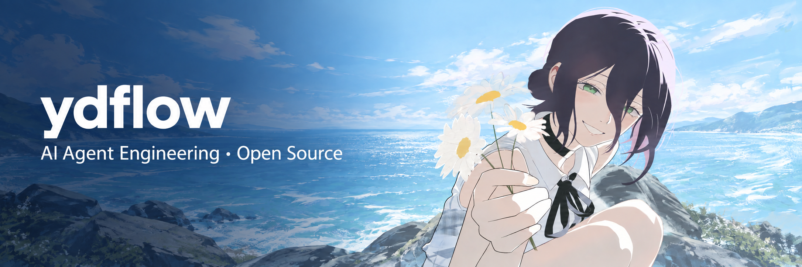
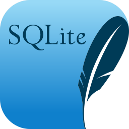
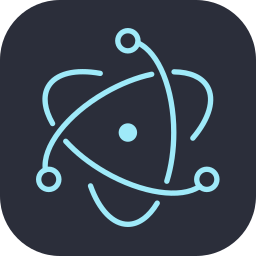

  

  

  
  
  

## 👋 关于我

你好，我是 **ydflow**，一名 **2028 届本科生**，目前正在寻找 **AI Agent 开发相关实习**。

我关注 **Agent Memory、评测与自进化 Agent**：记忆如何可靠写入、召回和更新，失败如何通过 Trace / Eval 复现，反馈如何证明下一轮行动确实更好。我在个人项目和已合并的上游 PR 中实践记忆召回、离线评测与执行可靠性，也持续跟进 RSI 的研究进展。在项目 [Trail · 研迹（正式版）](https://github.com/ydflow/Trail) 与 [研迹 · ResearchTrail（先行版）](https://github.com/ydflow/research-trail) 中，我已接入并探索双 Harness 架构，通过比较不同执行路径，为后续研究基于评测反馈的递归自我改进做准备。近期，我也在研究 **CMA-ES 与离散组合搜索**，探索如何生成候选策略、利用评测反馈调整搜索，并验证每轮改进是否有效。

我也探索 **AI 数字人**的交互与记忆表达，并将金融研究兴趣落实在本地 AI 投资研究工作台「研迹」。欢迎通过 [邮箱](mailto:m5a5@163.com) 交流。

## 🛠️ 技术与创作工具

  
  

  
  
  
  
  

---

## 上游贡献 · 已合并

- **权限与数据边界 · [AgentScope #2883](https://github.com/agentscope-ai/agentscope/pull/2883) / [WeKnora #4773](https://github.com/Tencent/WeKnora/pull/4773) / [TeamAI #1425](https://github.com/Tencent/teamai-cli/pull/1425)** — 修复可写 Git 命令的只读误判、非法知识库参数导致的检索范围扩大，以及符号链接让生成文件写出目标目录的问题。
- **长任务上下文 · [WeKnora #4672](https://github.com/Tencent/WeKnora/pull/4672) / [#4681](https://github.com/Tencent/WeKnora/pull/4681)** — 修正上下文溢出恢复时压缩错误历史、截断摘要仍被接受的问题，保住后续轮次需要的真实对话。
- **知识召回 · [TeamAI #891](https://github.com/Tencent/teamai-cli/pull/891) / [#902](https://github.com/Tencent/teamai-cli/pull/902) / [OpenViking #5312](https://github.com/volcengine/OpenViking/pull/5312)** — 统一多来源召回的排序尺度、隔离知识域 IDF 统计，并接通 DSH 插件的召回子树排除配置。
- **MCP 工具契约 · [AgentScope #3389](https://github.com/agentscope-ai/agentscope/pull/3389) / [Open Code Review #1770](https://github.com/alibaba/open-code-review/pull/1770)** — 保留仅含结构化内容的工具结果，完整读取分页的工具清单，避免 Agent 收到空结果或漏掉可用工具。
- **工具结果反馈 · [WeKnora #4766](https://github.com/Tencent/WeKnora/pull/4766) / [TeamAI #1439](https://github.com/Tencent/teamai-cli/pull/1439) / [Open Code Review #1773](https://github.com/alibaba/open-code-review/pull/1773)** — 保留模型拒绝文本，并让 MCP 配置未完成、评论批次全被丢弃时明确报错，不把失败说成成功。
- **并发与持久化 · [WeKnora #4755](https://github.com/Tencent/WeKnora/pull/4755) / [TeamAI #961](https://github.com/Tencent/teamai-cli/pull/961)** — 阻止迟到心跳恢复已释放的模型并发租约，并用锁与原子替换避免跨进程会话日志互相覆盖。
- **Windows Hook 兼容 · [TeamAI #1451](https://github.com/Tencent/teamai-cli/pull/1451)** — 修复 CodeBuddy 内置 Hook 在 Windows IDE 的 cmd.exe 下静默失效，同时兼容 Git Bash 执行路径。
- **沙箱 API 分页 · [CubeSandbox #1830](https://github.com/TencentCloud/CubeSandbox/pull/1830)** — 为沙箱列表补上游标分页，并同步 Python、Node、Go SDK 与 Web 前端，避免客户端只读到第一页。

## 项目实践

- **[Trail · 研迹（正式版）](https://github.com/ydflow/Trail)** — 已发布 Windows Beta 安装版与便携版的本地优先 AI 投资研究工作台；整合行情与 K 线、Agent 深度研究、证据溯源和投资逻辑复核，并以持久会话、断点恢复和离线评测检验研究流程。
- **[Pi Native CRM · Agent 原生 CRM](https://github.com/ydflow/pi-native-crm)** — 团队内部研发的 CRM 工作台；作为核心开发者之一，负责 Agent 受控执行链路，包括 CRM 工具授权、Pi/Harness 运行、持久 Worker 恢复及证据与 Eval 核验，使业务读写有边界、可追溯。
- **[研迹 · ResearchTrail（先行版）](https://github.com/ydflow/research-trail)** — 已发布 Windows v1.0.0 的本地 AI 投资研究工作台；使用py自研harness架构并且接入离线pi-agent-core架构，双harness为后续RSI递归自我进化做准备比较两者的区别 供自己学习与深层次理解，接入热力图等测试功能，为研迹正式版开发做测试。研迹正式版也已接入双harness。
- **[故障智巡 · Incident Response Agent](https://github.com/ydflow/incident-response-agent)** — 线上服务故障调查与模拟处置平台；在本地受控演示中只读取证、引用证据诊断，通过审批门控与事件回放记录决策；尚未接入生产处置。
- **[剪映自动化 Skill · Reliable Edition](https://github.com/ydflow/jianying-editor-skill-reliable)** — 在 [上游项目](https://github.com/luoluoluo22/jianying-editor-skill) 基础上的可靠性增强：草稿备份、只读诊断、版本预检、媒体保真与真实 MP4 转码。
- **[AI Digital Human](https://github.com/ydflow/cyber-girlfriend-16gb)** — 支持自定义角色的逐轮语音数字人原型；串联云端语音与对话服务、本地口型和表情视频生成。
- **[日序 · 每天都有安排](https://github.com/ydflow/rixu-miniprogram-open)** — 开发中的本地优先微信原生 TypeScript 日程小程序；支持事项、日历与专注，可选 CloudBase 同步。

---

  
  
  

